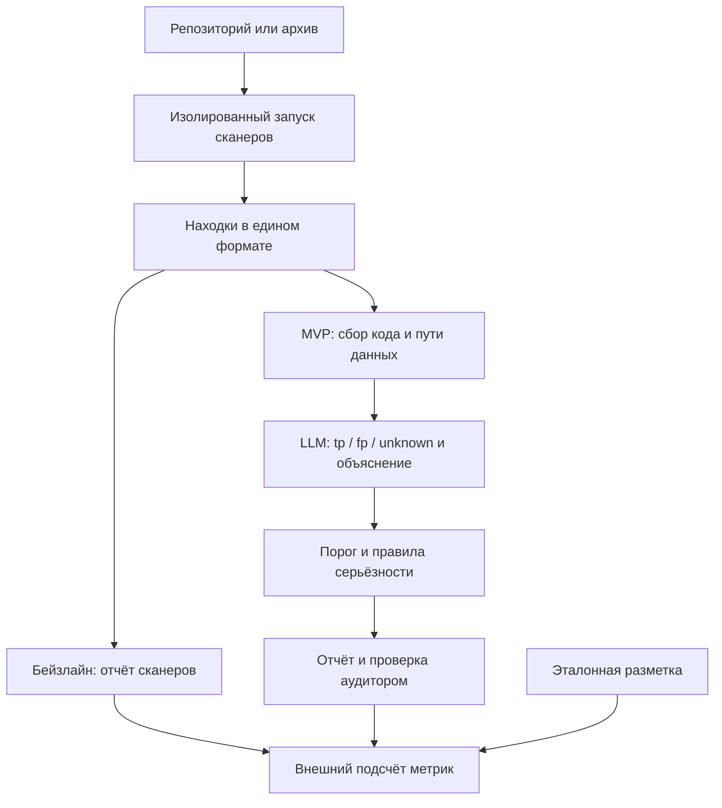

# Дизайн-документ ML-системы

**Проект:** проверка находок сканеров безопасности с помощью LLM

**Автор:** Струков Артур Павлович, ИТМО

**Версия:** 2.4, 2026-11-22

## 1. Цели и предпосылки

### 1.1. Зачем идем в разработку продукта?

Сканеры безопасности находят потенциальные уязвимости в коде. Аудитор проверяет каждую находку и решает, требует ли она исправления. Ложные срабатывания увеличивают время этой работы.

LLM получает находку сканера и связанный с ней код, оценивает наличие уязвимости и объясняет решение. Цель проекта: сократить число ложных срабатываний и время проверки, сохранив полноту сканеров.

| Метрика | Бейзлайн | Цель итерации 2 |
|---|---|---|
| Precision | 0.669 на OWASP Benchmark | ≥ 0.84 на том же наборе |
| Recall | 0.790 на OWASP Benchmark | сохранить recall бейзлайна на том же наборе |
| Доля ложных срабатываний | 33% на OWASP, 70% на собственном наборе | снизить минимум вдвое на каждом наборе |
| Время проверки одной находки аудитором | измеряем перед пилотом | сократить медиану минимум на 30% |
| Время проверки одной находки LLM | измеряем при подготовке пилота | p95 ≤ 2 минут |

Время проверки LLM считаем от начала сбора кода для находки до получения ответа, прошедшего проверку JSON-схемы. В замер входят повторные вызовы. Запуск сканеров и ожидание в очереди измеряем отдельно.

### 1.2. Бизнес-требования и ограничения

**Пользователи.** Разработчик получает список проблем перед релизом. Аудитор проверяет решения LLM и разбирает спорные находки.

**Словарь.** Находка: предупреждение сканера о потенциальной уязвимости. Для находки сохраняются два отдельных поля: решение LLM (`tp`, `fp`, `unknown`) и статус проверки (`pending`, `confirmed`, `rejected`). Статус проверки назначает аудитор или система по результатам воспроизведения уязвимости.

**Требования:**

- На входе ссылка на репозиторий или архив, на выходе отчёт JSON/HTML/PDF.
- Каждая находка содержит файл, строки, CWE, серьёзность, источник и объяснение решения.
- В первую очередь проверяем находки уровней Medium, High и Critical. Находки Low сохраняем в журнале и отправляем в LLM по запросу аудитора.
- В отчёте сохраняем исходные находки, решения LLM и статус проверки каждой находки.
- LLM проверяет находки сканеров. Поиск уязвимостей, пропущенных сканерами, исключён из итерации 2.
- Сканеры запускаются в контейнере без сети. Исходники доступны только для чтения. Ограничиваем процессорное время, память и число процессов; команды выбираем из заранее заданного списка.
- Внешняя LLM получает код с разрешения владельца. Перед отправкой локальная проверка маскирует секреты и проверяет допустимые пути. Если передача кода запрещена или очистку нельзя проверить, находку разбирает аудитор.
- Стоимость проверки одной находки LLM, включая повторы, должна быть меньше $1. Также задаём бюджет всего аудита. Перед каждым вызовом система проверяет оба лимита.
- Уязвимости воспроизводим только на разрешённых локальных учебных стендах.

### 1.3. Что входит в скоуп проекта/итерации, что не входит

| Итерация | Результат |
|---|---|
| 1. Сканеры | Изолированный запуск Semgrep, Bandit, gitleaks и OSV-Scanner, единый формат находок и измеренный бейзлайн |
| 2. Верификатор, текущая | Проверка находок готовыми LLM, сбор контекста, выбор модели, оценка качества, времени и стоимости |
| 3. Патчер, запланирована | Отдельный вызов LLM по подтверждённой находке; результат `patch.diff` и объяснение исправления |

В итерации 3 патч создаётся для конкретного коммита. Система пробует применить его в рабочей копии, проверяет синтаксис, запускает тесты и сканеры. Пользователь просматривает изменения и решает, применять ли патч. Эксперимент и бюджет итерации 3 планируются отдельно.

В проект входят Python, JavaScript/TypeScript и Java. Дообучение моделей, автоматическое применение патчей и проверка чужих работающих сервисов исключены.

### 1.4. Предпосылки решения

| Предпосылка | Основание | Проверка |
|---|---|---|
| LLM может повысить precision отчёта сканеров | Бейзлайн OWASP: precision 0.669, recall 0.790 | Повторный замер на закреплённых версиях |
| Путь данных помогает LLM проверять находки | Подход ZeroFalse | Сравнение фрагмента кода и пути данных |
| Качество на учебном наборе переносится на рабочий код | OWASP содержит Java-кейсы с разметкой CWE | Отдельная оценка на независимых проектах Python, JS/TS и Java |

## 2. Методология

### 2.1. Постановка задачи

Бинарная классификация находки: TP означает реальную уязвимость, FP означает ложное срабатывание. При недостатке контекста LLM возвращает `unknown`, находку проверяет аудитор.

На вход подаём правило сканера, CWE, фрагмент кода и путь от внешнего ввода до опасной операции. В путь включаем функции, которые проверяют или очищают данные. Модель возвращает JSON с решением, объяснением и ссылками на строки.

Precision = TP/(TP+FP), recall = TP/(TP+FN). Метрики считаем по сохранённым находкам, включая переданные аудитору. Для расчёта recall используем полный список эталонных уязвимостей, чтобы учесть пропуски сканеров. Результаты до и после ручной проверки показываем отдельно.

| Серьёзность | Цель precision | Условие по recall | Порядок проверки |
|---|---|---|---|
| High/Critical | ≥ 0.90 после проверки аудитором | сохранить уровень сканеров | Аудитор проверяет каждую находку |
| Medium | ≥ 0.80 | сохранить уровень сканеров | Решение по категориям LLM, как описано ниже |
| Low | измеряем отдельно | сохраняем исходные находки | По запросу аудитора |

Для обработки используем три группы: High/Critical, Medium и Low. High и Critical проходят одинаковую обязательную проверку аудитором, поэтому объединены в одну группу с общей целью precision ≥ 0.90. Исходный уровень сканера сохраняем в находке и показываем в отчёте.

Серьёзность определяем по правилу сканера и коду. В отчёте приводим TP/FP/FN и метрики отдельно для каждого CWE, языка и уровня серьёзности. При отсутствии примеров указываем «недостаточно данных».

Recall сравниваем с бейзлайном на одинаковых находках и эталонах. Проверяем разность `ΔR = R_LLM − R_SAST`; допустимое снижение равно нулю. Для сравнения строим односторонний 95% интервал по независимым проектам, для OWASP по семействам тестов. Нижняя граница должна быть ≥ 0 в целом и отдельно для Medium и объединённой группы High/Critical. Если интервал пересекает ноль, продолжаем пилот и показываем аудитору все исходные находки. Для разности precision также рассчитываем 95% доверительный интервал на одних и тех же проектах.

### 2.2. Блок-схема решения

Команды запуска задаёт система. Код репозитория служит контекстом для LLM. Система проверяет формат ответа по JSON-схеме и отдельно сохраняет статус проверки находки.

### 2.3. Этапы решения задачи

В ДЗ2 выполнен [EDA OWASP Benchmark](../reports/eda.md). В репозитории сохранены [численные результаты](../reports/eda_summary.json) и скрипт `scripts/eda.py`. Следующие этапы описывают реализацию MVP. Измерения из ДЗ1 приведены в конце раздела.

#### Этап 1. Подготовка данных

**Данные и разметка.** LLM обрабатывает одну находку сканера. Эталон OWASP описывает тестовый файл. Одному файлу соответствует от нуля до нескольких находок. Каждая находка ссылается на файл и коммит проекта. Эксперт сопоставляет её с разметкой по CWE и положению уязвимости в коде.

| Данные | Источник и готовность | Кто готовит |
|---|---|---|
| Метка TP/FP | В CSV OWASP есть имя теста, CWE и наличие уязвимости. Метку находки получаем после сопоставления с разметкой | DS, эксперт безопасности |
| Признаки находки | Правило, CWE, файл, строки и серьёзность из вывода сканера | DE |
| Контекст для LLM | Код на выбранном коммите, путь данных от внешнего ввода до опасной операции, функции проверки и очистки данных | ML Engineer |
| Независимая выборка | Требуется собрать проекты Python, JS/TS и Java с экспертной разметкой | DE, эксперты безопасности |

**Что показал EDA.** Проверены 2740 тестов OWASP: 1415 уязвимых и 1325 безопасных, 11 CWE. Обязательные поля заполнены, ID уникальны, исходники доступны для всех тестов. После удаления комментариев и нормализации имён найдены четыре дубликата сверх первого экземпляра. Длина исходников составляет 51–206 строк, медиана 100.

CSV содержит метку файла. Для оценки находок по строкам эксперт должен дополнительно отметить положение уязвимости. Ложное срабатывание определяем после запуска сканера и сопоставления находки с разметкой.

**Достаточность данных.** OWASP хватает для технического MVP: можно проверить загрузку данных, запуск сканеров, сбор кода и формат ответа LLM. Для выбора промпта и правил обработки нужна выборка размеченных находок. Для оценки пилота собираем независимые проекты на трёх языках. OWASP покрывает учебные Java-тесты, собственный набор из 20 уязвимостей используется для проверки работоспособности.

Начальный объём пилота: минимум 2000 находок из 20 или более проектов. Для примеров в промпте выделяем минимум 1000 находок, для настройки 400, для закрытого теста 600, включая минимум 300 TP. Части формируем по проектам; при нехватке TP или примеров нужного языка, CWE и серьёзности добавляем проекты. Фактическое число находок в каждой части записываем после разбиения. Объём уточняем по интервалу разности recall и числу примеров каждого CWE и уровня серьёзности. Если данных мало для вывода, добавляем проекты и сохраняем ручную проверку всех находок.

**Подготовка.** DE сохраняет коммит, лицензии и хеши исходников, запускает сканеры в контейнере и записывает их исходный JSON. DS приводит пути и CWE к единому формату, группирует дубликаты и сопоставляет находки с разметкой. Для находки сохраняем ID проекта, коммит, язык, версии сканера и правил, ID правила, CWE, строки, фрагмент кода, путь данных, метку и её источник. Находки gitleaks и OSV проверяем по отдельным правилам для секретов и зависимостей.

Два эксперта независимо размечают всю тестовую выборку и 20% данных для настройки. Спорные случаи разбирает третий эксперт.

**Результат этапа:** исходники, находки и эталоны с версиями, а также список проектов в каждой части выборки. При изменении кода, сканера или правил создаём новый снимок данных. DS и эксперт проверяют заполнение полей и соответствие меток коду.

#### Этап 2. Подготовка верификатора

**Бейзлайн.** B0 выдаёт находки сканеров после удаления дубликатов. B1 проверяет тот же список одной LLM с фиксированным промптом без примеров. Модель получает фрагмент кода и CWE, возвращает JSON с решением, объяснением и ссылками на строки. При таймауте, неверном JSON или недостатке кода находку проверяет аудитор.

**MVP.** К фрагменту кода добавляем путь данных от внешнего ввода до опасной операции. Сначала используем путь из отчёта сканера. Если его нет, восстанавливаем путь по определениям аргументов и графу вызовов. В контекст включаем проверки, очистку данных и ветвления, влияющие на выполнение операции. Если путь восстановлен частично, ставим `incomplete` и передаём находку аудитору.

Первой вызываем дешёвую модель. Если путь проходит через несколько функций или модель вернула `unknown`, вызываем более сильную модель в пределах бюджета. При расхождении решений находку проверяет аудитор. Все находки High и Critical также проходят ручную проверку. Для Medium используем категории ответа: `tp` сохраняет находку в отчёте, `unknown` передаёт её аудитору. Ответ `fp` дешёвой модели проверяет более сильная модель. Находку исключаем из основного списка только при двух ответах `fp`, полном пути данных и корректном JSON. Исходная находка и оба решения остаются в журнале. Расхождение ответов, ошибка вызова или нехватка бюджета направляют находку аудитору.

Числовую уверенность модель не возвращает. Решение принимаем по категориям и перечисленным правилам. Автоматическое исключение Medium включаем после выполнения проверки recall из 2.1; до этого аудитор видит все находки.

**Настройка.** Разбиваем проекты на части для примеров, настройки и итогового теста с минимальными объёмами из этапа 1. Фиксируем seed=42 и список проектов в каждой части. Проект, его форки и похожие шаблоны держим вместе. Это же правило действует для пар уязвимого и исправленного кода.

На выборке для настройки сравниваем четыре сочетания: фрагмент кода или путь данных, ноль или три примера в промпте. Фрагмент без полного пути используем для сравнения качества; его решения `fp` проверяет аудитор. Для автоматического исключения находок требуется полный путь данных. Перед итоговым тестом фиксируем модели, промпты и параметры. Метки и комментарии с готовыми ответами исключаем из контекста.

**Проверка качества.** Считаем precision, recall, F1 и TP/FP/FN отдельно по языкам, CWE и серьёзности. Дополнительно показываем долю сохранённых TP сканера и recall по всем эталонным уязвимостям. Сравниваем B0, B1 и MVP на одних проектах; для OWASP группируем тесты по семействам шаблонов. Условия приёмки приведены в 2.1.

Три вызова LLM на одинаковых входных данных показывают разброс решений. Эксперт разбирает все FN и выборку FP/TP, выделяя ошибки сбора кода, сопоставления с разметкой и решения модели.

**Результат этапа:** выбранные модель, промпт и правила обработки, метрики с интервалами, разбор ошибок, замеры времени и стоимости. Ответы кешируем по хешам кода, промпта и модели. При изменении любого из них повторяем оценку.

#### Этап 3. Проверка находок

В бейзлайне сканеры работают в контейнере с ограничениями из 1.2. Проверки изоляции перечислены в 4.4.

В MVP добавляем воспроизведение уязвимости на разрешённом локальном стенде. Для каждого случая заранее задаём наблюдаемый эффект, который подтверждает нарушение безопасности. Повторяем проверку в трёх чистых окружениях. Сервис сохраняет критерий и результаты запусков, эксперт подтверждает вывод. Перед автоматическим назначением `confirmed` дополняем схему БД по требованиям 4.4. Нарушение изоляции останавливает пилот.

**Результат этапа:** протокол проверки изоляции, материалы воспроизведения и статус каждой находки.

#### Этап 4. Отчёт и проверка аудитором

Бейзлайн выдаёт JSON/HTML с файлом, строками, CWE и источником находки. MVP добавляет PDF, результаты воспроизведения, решения LLM и список находок для аудитора. Находки `confirmed` и `pending` отображаются отдельно. Аудитор измеряет время проверки и отмечает, помогло ли объяснение модели.

Генерация патчей запланирована на итерацию 3, описанную в 1.3.

**Результат этапа:** отчёт и замечания аудитора, связанные с коммитом проекта. Исправленные метки включаем в следующую версию данных.

#### Этап 5. Пилот и мониторинг

Сравниваем B0, B1 и MVP на одних коммитах независимых проектов. Измеряем качество, время и стоимость по правилам разделов 1–3. Отдельно считаем полные расходы и длительность аудита в зависимости от числа находок.

После пилота отслеживаем состав языков и CWE, объём кода для LLM, число находок на ручной проверке, ошибки API, стоимость и задержки. Ежемесячно эксперт размечает выборку для проверки качества. При смене модели или правил проводим новую оценку. Если recall снизился, возвращаемся к B0; нарушение изоляции останавливает анализ.

#### Результаты бейзлайна

Измерения ДЗ1:

| Эталон | Precision | Recall | F1 |
|---|---|---|---|
| OWASP Benchmark 1.2 (строгое равенство CWE) | 0.669 | 0.790 | **0.725** |
| OWASP Benchmark 1.2 (с учётом семейств CWE) | 0.693 | 0.882 | 0.776 |
| Собственный seeding-набор | 0.302 | 0.800 | **0.438** |

## 3. Подготовка пилота

### 3.1. Способ оценки пилота

Для каждого проекта запускаем сканеры и сканеры с LLM на одном коммите. Версии сканеров, правила и порядок сопоставления с эталоном фиксируем. При расчёте доверительных интервалов сравниваем результаты для одних и тех же проектов.

Чтобы измерить время работы аудитора, распределяем сопоставимые находки между проверкой с LLM и без неё. Порядок перемешиваем. Каждый аудитор видит конкретную находку один раз. В замер входят чтение объяснения и разбор `unknown`.

### 3.2. Что считаем успешным пилотом

Пилот успешен, если выполнены все условия:

- precision и доля ложных срабатываний достигли целей из 1.1;
- recall сохранён по правилам 2.1, в том числе по уровням серьёзности;
- медиана времени аудитора сократилась минимум на 30%;
- p95 проверки LLM составляет не более 2 минут на находку;
- стоимость проверки LLM меньше $1 на находку.

До выполнения условий аудитор проверяет решения системы.

### 3.3. Подготовка пилота

Перед пилотом измеряем на проверочной выборке расход токенов, число вызовов, время и стоимость. По результатам выбираем модели, правила обработки, лимит попыток и бюджет. Отдельно рассчитываем расходы на большой репозиторий с 5000 находками.

## 4. Внедрение

### 4.1. Архитектура решения

Сервис принимает ссылку на репозиторий или архив, запускает сканеры в контейнере и сохраняет находки в БД. Верификатор собирает код для каждой находки и вызывает LLM. Модуль отчётов объединяет результаты сканеров и LLM.

### 4.2. Описание инфраструктуры и масштабируемости

Сканеры работают на CPU в Docker. Запросы к LLM поступают в очередь. Число одновременных вызовов ограничиваем с учётом квот провайдера. Нагрузку измеряем числом находок и объёмом кода, переданного модели.

### 4.3. Требования к работе системы

Контролируем время проверки LLM на одну находку, ожидание в очереди и время запуска сканеров. При таймауте, ошибке API или исчерпании бюджета находку проверяет аудитор.

### 4.4. Безопасность системы

Проверяем попытки доступа за пределы рабочего каталога, обход ограничений через символические ссылки, архивные бомбы и инструкции для агента внутри файлов. Повторяем проверки с намеренно ослабленной изоляцией: тесты должны обнаружить нарушение.

Уязвимость подтверждает аудитор или система после воспроизведения нарушения по заранее заданному критерию. Повторное предупреждение сканера показывает стабильность его работы. Сейчас ограничение CHECK в БД проверяет три повтора. Перед автоматическим подтверждением добавляем тип проверки, критерий и материалы, подтверждающие результат.

### 4.5. Безопасность данных

Перед внешним вызовом система проверяет разрешение на передачу кода и результат очистки по требованиям 1.2. В логи записываем ID находки, модель, версию промпта, статус, токены и стоимость. Сохранённый контекст шифруем, доступ предоставляем по ролям. В пилоте храним его 30 дней.

### 4.6. Издержки

Стоимость проверки находки складывается из оплаты входных и выходных токенов всех вызовов. Тарифы сохраняем вместе с датой. Отдельно учитываем затраты на CPU и время аудитора.

Месячная оценка: `число аудитов × среднее число находок × средняя стоимость проверки LLM + CPU + хранение`. Расчёт заполняем после пробного прогона. Затраты на патчер рассчитаем при подготовке итерации 3.

### 4.7. Точки интеграции

Вход: репозиторий или архив. Выход: отчёт и находки с ID аудита. Вместе с результатами сохраняем исходный коммит и версии сканеров, правил, моделей и промптов.

### 4.8. Риски

| Риск | Действие |
|---|---|
| LLM отклоняет TP | Сравнение recall, ручная проверка High/Critical, возврат к отчёту сканеров при ухудшении |
| Публичные тесты знакомы модели | Независимые проекты, отдельная оценка OWASP |
| Решения меняются между вызовами | Три повтора, фиксированные версии и параметры, публикация разброса |
| Закончились квоты API | Ограниченные повторы, передача находок аудитору |
| Нарушена изоляция | Остановка анализа и пилота |

## Источники

1. «Sifting the Noise»: сравнение SAST на OWASP Benchmark, arXiv:2601.22952
2. «ZeroFalse»: подача пути потока данных модели, arXiv:2510.02534
3. «RealSec-bench»: арбитраж несколькими моделями, arXiv:2601.22706
4. «LMPFA»: промышленная фильтрация ложных срабатываний, arXiv:2601.18844
5. «QASecClaw»: мульти-агентная фильтрация, arXiv:2605.01885
6. «SAST-Genius»: LLM-триаж поверх Semgrep, arXiv:2509.15433
7. «SecLens»: оценка LLM без инструментов, arXiv:2604.01637
8. Frame: LLM в связке с разделяющей логикой, LambdaSec
9. OWASP Benchmark: https://github.com/OWASP-Benchmark/BenchmarkJava
10. Шаблон дизайн-документа Reliable ML: https://github.com/IrinaGoloshchapova/ml_system_design_doc_ru/blob/main/ML_System_Design_Doc_Template.md
