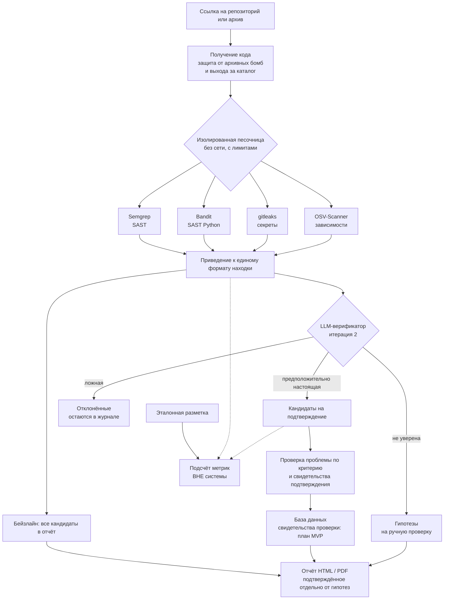
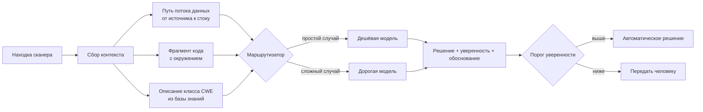
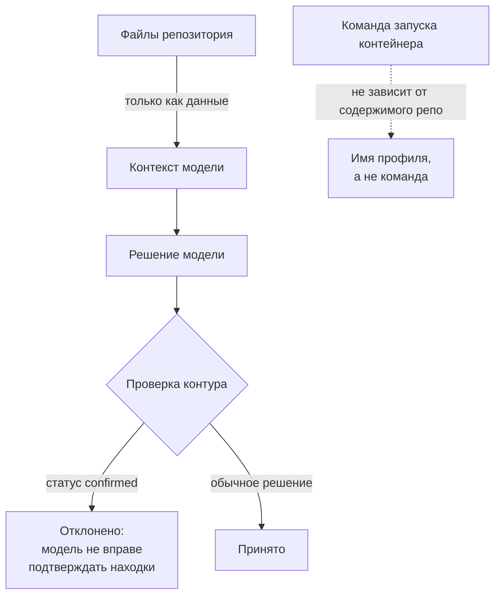

# Дизайн-документ ML-системы

**Проект:** агентный harness для аудита безопасности репозиториев с ИИ-сгенерированным кодом

**Автор:** Струков Артур Павлович, ИТМО

**Версия:** 2.1 · 2026-11-18

**Статус:** итерация 1 реализована и измерена, итерация 2 в разработке

---

## 1. Цели и предпосылки

### 1.1. Зачем идем в разработку продукта?

#### Бизнес-цель

Объём кода, написанного с помощью ИИ-ассистентов, растёт быстрее, чем способность команд его проверять. По исследованиям 2022–2026 годов от 25% до 45% ИИ-сгенерированного кода содержит уязвимости. При этом существующие способы проверки плохо масштабируются:

| Способ | Ограничение |
|---|---|
| Ручной аудит / пентест | 5–30 тыс. долларов за приложение, сроки от двух недель |
| Детерминированные сканеры (SAST) | дёшево и быстро, но доля ложных срабатываний в промышленном коде превышает 90% |
| LLM без инструментов | почти не ошибается в том, что назвала, но находит каждую десятую уязвимость |

Возникает разрыв: дешёвые инструменты шумят, точные — дороги. Команда, выпускающая продукт с ИИ-кодом, вынуждена либо платить за аудит, либо разбирать сотни предупреждений вручную, либо выпускать без проверки.

#### Почему здесь нужен ML

Задача триажа находки — «это настоящая уязвимость или ложное срабатывание» — требует понимания контекста приложения, а не совпадения с шаблоном. Это ровно та граница, где детерминированные правила упираются в потолок, и ровно та задача, где языковая модель применима: на вход подаётся путь потока данных и окружающий код, на выходе — решение и обоснование.

Шесть независимых опубликованных работ 2025–2026 годов показывают сокращение ложных срабатываний на 77–98% при сохранении полноты, когда LLM работает поверх вывода сканеров. Самая осторожная из них (Frame, единственная с базовой линией, измеренной тем же автором на том же корпусе) даёт прирост скромнее: F1 с 0.45 до 0.58. Это и есть реалистичный ориентир, на который мы планируем.

#### Бизнес-метрики успеха

| Метрика | Текущее значение (итерация 1) | Целевое (итерация 2) |
|---|---|---|
| Доля ложных срабатываний в отчёте | 33% на OWASP Benchmark, 70% на собственном наборе | снижение не менее чем вдвое |
| Precision итогового списка | 0.669 на OWASP Benchmark | не ниже 0.84 на том же тесте и при соблюдении ограничения recall |
| Recall итогового списка | 0.790 на OWASP Benchmark | не ниже baseline на том же тесте; 0.790 — ориентир только для этого корпуса |
| Время триажа одной находки | ручной baseline ещё не измерен; 1–15 минут на репозиторий несопоставимы с этой единицей | p95 машинной верификации ≤ 2 минут на находку; уменьшение медианы активного времени аудитора ≥ 30% |

Ключевое ограничение на цель: **снижение ложных не должно достигаться ценой полноты**. Система, которая молчит, бесполезна, даже если никогда не ошибается. LLM только фильтрует кандидатов сканеров: поиск пропущенных сканером уязвимостей не входит в итерацию 2, поэтому роста recall относительно SAST не обещаем. Precision = TP/(TP+FP), recall = TP/(TP+FN); считаются для итогового списка, включая гипотезы для ручной проверки, а не только подтверждённые находки. Цели precision и времени предварительные, это не результаты измерений. В пилоте аудитор разбирает одинаковые по сложности находки с LLM и без неё; учитывается также время проверки объяснения и ручного разбора неопределённых ответов.

### 1.2. Бизнес-требования и ограничения

#### Пользователи и сценарии

| Роль | Сценарий | Что для неё важно |
|---|---|---|
| Разработчик / небольшая команда | прогнать проект перед релизом или выкладыванием в открытый доступ | скорость, понятность, мало шума |
| Аудитор безопасности | получить список кандидатов на ручную проверку, отсортированный по уверенности | полнота, прослеживаемость, воспроизводимость |
| Нетехнический заказчик | понять уровень риска продукта, который ему сдают | отчёт человеческим языком, разделение «подтверждено» и «гипотеза» |

#### Функциональные требования

1. На входе — ссылка на репозиторий или архив; на выходе — отчёт с находками. Верификатор разбирает кандидатов SAST; поиск пропущенных сканерами уязвимостей остаётся за рамками итерации. Для оценки полноты внешний evaluator хранит весь эталон, включая пропуски сканера.
2. Каждая находка содержит: файл, строки, класс уязвимости (CWE), серьёзность, объяснение и источник (какой инструмент или модель её дали). Приоритет пилота — Medium, High, Critical; Low остаётся в исходном журнале и по умолчанию не отправляется в LLM.
3. Находки разделены на **подтверждённые** и **гипотезы**; смешивать их в отчёте запрещено.
4. В итерации 2 выдаются решение и объяснение, без генерации патча. Отдельный LLM-патчер планируется для следующей итерации: он получает подтверждённую находку, её контекст и решение верификатора и предлагает файл `patch.diff` в формате unified diff плюс объяснение изменения. Это отдельный вызов модели, а не часть классификации. Если безопасное исправление не найдено, возвращается рекомендация без diff. Патч проверяется на применимость и тестируется в отдельной рабочей копии; пользователь просматривает diff и сам решает, применять ли его. Коммиты и PR автоматически не создаются. Исходный commit SHA сохраняется для проверки и отката.
5. Отчёт выгружается в HTML и PDF.

#### Нефункциональные требования и ограничения

**Безопасность исполнения (критично).** Система запускает недоверенный код и читает недоверенный текст. Отсюда жёсткие требования, вынесенные в отдельную модель угроз:

- анализ только в изолированном контейнере: без сети, с лимитами памяти и числа процессов, с файловой системой только на чтение и снятыми привилегиями;
- содержимое анализируемого репозитория **никогда не управляет действиями агента** — текст из README не может изменить команду запуска или повысить привилегии;
- доля действий вне разрешённого списка целей должна быть **нулевой**, это проверяется отдельным набором враждебных тестов.

**Надёжность оценки.** Повторное срабатывание сканера 3 раза из 3 подтверждает стабильность, но не наличие уязвимости. Статус `confirmed` требует свидетельства нарушения безопасности по заранее заданному критерию в разрешённом локальном стенде или документированного ручного подтверждения экспертом. LLM выдаёт только гипотезу. В текущей реализации `CHECK (status <> 'confirmed' OR reproduced_runs >= 3)` проверяет лишь повторы; до автоматического подтверждения нужно дополнить схему видом проверки, критерием и ссылкой на свидетельство. Это технический долг, а не реализованная гарантия.

**Честность измерений.** Метрики считаются **снаружи** системы отдельным кодом, чтобы она не могла влиять на собственную оценку.

**Стоимость.** Верхняя граница — строго меньше $1 на верификацию одной находки, включая все повторные и резервные вызовы. Это ограничение, а не показатель успеха и не целевая средняя цена. До пилота замеряем число входных/выходных токенов и обращений к каждой модели: `C = Σ(input_tokens × input_rate + output_tokens × output_rate)`. Ставки задаются за токен и фиксируются вместе с провайдером и датой. CPU и труд аудитора учитываются отдельно при сравнении полной стоимости триажа. Для N находок стоимость LLM равна сумме их затрат: 5000 находок нельзя считать аудитом за $1. Перед каждой попыткой проверяется остаток бюджета находки и аудита; при исчерпании лимита находка передаётся человеку. Бесплатные квоты не считаются гарантией нулевой стоимости после пилота.

**Ресурсы.** Корпоративных ключей и GPU нет. Бюджет на модели — бесплатные лимиты (Gemini Flash / Flash-Lite), поэтому дорогая модель применяется точечно, а массовые операции уходят на дешёвую.

**Юридические и этические ограничения.** Корпус собирается только из открытых источников. Модуль активной проверки работает исключительно на локальных учебных стендах; атаки на чужие работающие системы исключены, в том числе в тестах.

#### Что считаем провалом

Проект считается неуспешным, если выполнено хотя бы одно:

- полнота итогового списка упала относительно SAST на том же тесте ради снижения ложных срабатываний;
- хотя бы один враждебный сценарий пробил изоляцию песочницы;
- прирост качества от LLM-слоя статистически неотличим от нуля **и** при этом не измерена стоимость — то есть нет ни пользы, ни знания о цене.

Третий пункт важен: отрицательный результат при корректном измерении — приемлемый исход, необъяснённый результат — нет.

### 1.3. Что входит в скоуп проекта/итерации, что не входит

Проект разбит на итерации, каждая из которых соответствует одной из четырёх сравниваемых конфигураций.

#### Итерация 1 — базовая линия (завершена и измерена)

**Входит:**

- изолированная песочница на Docker с проверенными враждебными тестами;
- четыре детерминированных сканера (Semgrep, Bandit, gitleaks, OSV-Scanner), приведение их вывода к единому формату находки;
- два размеченных эталона: собственный набор из 20 внедрённых уязвимостей и OWASP Benchmark 1.2 на 2740 кейсов;
- код подсчёта метрик вне системы, HTTP-интерфейс, база данных.

**Результат:** базовая линия, с которой сравнивается всё остальное.

#### Итерация 2 — LLM-верификатор (текущая)

**Входит:**

- классификатор «настоящая уязвимость / ложное срабатывание» поверх находок сканеров;
- подача модели пути потока данных, а не голого фрагмента кода;
- маршрутизация между дешёвой и дорогой моделью;
- измерение прироста и стоимости.

**Не входит:** дообучение модели, собственная модель, активная эксплуатация, поиск вне кандидатов SAST и генерация патчей.

#### Что не входит в проект вообще

| Исключено | Почему |
|---|---|
| Обучение или дообучение своей модели | нет GPU и размеченного корпуса нужного объёма; задача решается промптингом поверх готовой модели |
| Автоматическое применение патчей без человека | цена ошибки в безопасности слишком высока; патч предлагается, решение принимает человек |
| Сканирование работающих чужих систем | этическое и юридическое ограничение, зафиксировано в модели угроз |
| Поддержка всех языков программирования | в скоупе Python, JavaScript/TypeScript и Java; остальные — за рамками |
| Интеграция с коммерческими платформами (Snyk, Sonar) | не нужна для научного результата |

#### Критерий завершения итерации

Итерация считается законченной, когда измерены precision, recall, F1, время и стоимость на доступных эталонах и независимом корпусе, соблюдены критерии пилота из раздела 3, результат воспроизводится командой из одной строки, а ограничения перечислены в отчёте.

### 1.4. Предпосылки решения

Допущения, на которых построена система. Если допущение окажется неверным, это меняет архитектуру, поэтому каждое сопровождается проверкой.

| # | Допущение | На чём основано | Как проверяем |
|---|---|---|---|
| 1 | Сканеры дают высокую полноту при низкой точности | измерено нами: recall 0.790 при precision 0.669 на OWASP Benchmark | повторный замер на каждой итерации |
| 2 | LLM без инструментов даёт обратный профиль — высокую точность при низкой полноте | SecLens: precision 0.80 при recall 0.10 | итерация 3 воспроизводит это на наших данных |
| 3 | Связка «сканер как генератор кандидатов + LLM как верификатор» лучше каждого по отдельности | шесть опубликованных работ, сокращение ложных на 77–98% | итерация 2, прямое сравнение с нашей же базовой линией |
| 4 | Качество верификации зависит от того, **что** подано модели, а не только от модели | ZeroFalse: подача пути потока данных даёт F1 0.955 | A/B: фрагмент кода против пути данных |
| 5 | Статический анализ детерминирован, разброс метрик не маскирует эффект | измерено: три прогона, стабильность 1.000 | повтор при добавлении LLM, где разброс ожидается |
| 6 | Разметка пригодна для сопоставления с находками | EDA ДЗ2: у OWASP есть имя теста и CWE; строки требуют экспертной локализации | перед построчной оценкой размечаем положение уязвимости |

Допущение 6 уже сработало как фильтр: OWASP Juice Shop пришлось исключить из подсчёта метрик, потому что его разметка описывает эксплуатацию в рантайме и не содержит ни файла, ни строки, ни класса уязвимости. Он остался только как описательный прогон.

## 2. Методология

### 2.1. Постановка задачи

#### Формулировка в терминах ML

**Задача:** бинарная классификация находок статического анализа.

- **Объект:** одна находка сканера — файл, диапазон строк, класс уязвимости (CWE), правило, фрагмент кода и путь потока данных от источника ввода до опасной операции.
- **Целевая переменная:** `1` — настоящая уязвимость, `0` — ложное срабатывание.
- **Разметка:** из эталонов. У собственного набора она известна по построению, у OWASP Benchmark берётся из файла `expectedresults-1.2.csv`.
- **Подход:** промптинг готовой языковой модели без дообучения; модель возвращает решение, уверенность и обоснование.

Классификатор работает **поверх** вывода сканеров, а не вместо него: это сознательное решение, поскольку полнота у сканеров уже высокая, а узкое место — точность.

#### Метрики

**ML-метрики:**

| Метрика | Роль | Текущее значение |
|---|---|---|
| Recall | главное ограничение, не должен падать | 0.790 |
| Precision | то, что улучшаем | 0.669 |
| F1 | сводная | 0.725 |

**Правило сопоставления находки с эталоном** («один к одному»): эталонная уязвимость закрывается не более чем одной находкой. Совпадением считается одинаковый файл и класс уязвимости при разнице строк не больше допуска; пары разбираются жадно, от лучшего совпадения к худшему. **Вторая находка на ту же уязвимость считается ложным срабатыванием** — без этого дубли четырёх инструментов завышали бы точность, хотя разработчику всё равно придётся разобрать каждую строку отчёта.

Устойчивость правила проверена: при допуске от 1 до 10 строк метрики не меняются, то есть числа не подогнаны выбором параметра.

**Технические метрики:** время прогона, стоимость в токенах и деньгах, доля отказов модели, стабильность между повторными прогонами.

#### Главный проверяемый результат

Сравнение четырёх конфигураций на одних репозиториях, одной модели и одном бюджете:

| # | Конфигурация | Статус |
|---|---|---|
| 1 | Только детерминированные инструменты | измерена |
| 2 | Инструменты + LLM-верификатор | в разработке |
| 3 | LLM без инструментов | запланирована |
| 4 | Сторонний открытый харнес на той же модели | запланирована |

**Δ(2−1)** — вклад модели. **Δ(2−3)** — вклад инструментов и оркестрации.

Такого сравнения на единых условиях в рассмотренных работах не найдено: у каждой работы свой корпус и своя базовая линия. Это и есть исследовательский вклад проекта.

#### Где именно ожидается прирост

Карта по классам уязвимостей, измеренная на OWASP Benchmark, показывает, что прирост возможен не везде:

| Класс | Recall | Ложных | Есть ли запас для LLM |
|---|---|---|---|
| CWE-330, CWE-327, CWE-614 | 1.000 | 0 | нет, улучшать нечего |
| CWE-89, CWE-78, CWE-22 (инъекции) | 0.90–0.93 | сотни | да, по точности |
| CWE-79 (XSS) | 0.821 | 108 | да, по точности; полноту требуется сохранить |
| CWE-501 (граница доверия) | **0.518** | 18 | проверяем снижение ложных при сохранении полноты; пропуски SAST здесь не исправить |

Там, где признак локален — вызов конкретной функции, отсутствие флага, — полнота уже равна единице при нуле ложных, и модель не нужна. Там, где требуется понять замысел приложения, полнота падает до 0.518. Это ограничение генератора кандидатов. Для её повышения понадобился бы отдельный механизм поиска, которого в итерации 2 нет.

#### Проверка качества и серьёзности

| Уровень | Предварительная цель precision | Ограничение recall и автоматизация |
|---|---|---|
| Critical | ≥ 0.90 | recall не ниже baseline; автоматическое отклонение запрещено |
| High | ≥ 0.85 | recall не ниже baseline; автоматическое отклонение запрещено |
| Medium | ≥ 0.80 | recall не ниже baseline; отклонение только при прохождении проверки ниже |
| Low | измеряем отдельно без целевого порога | LLM по умолчанию не вызывается; исходные находки сохраняются |

Уровень берётся из фиксированного отображения правил сканера и контекста, а не из уверенности LLM. Понижать серьёзность решением модели для обхода ограничений нельзя. Если в срезе нет TP или нет выданных находок, соответствующая метрика не определена, а не равна нулю или единице. Публикуются TP/FP/FN, размер среза и интервалы по CWE, языку и серьёзности; цели нельзя переносить между корпусами без нового baseline.

На независимом test считаем парную разность recall `ΔR = R_MVP − R_SAST`. Допустимое снижение равно нулю: нижняя односторонняя 95% граница ΔR должна быть ≥ 0 как в целом, так и для каждого уровня Medium/High/Critical. Интервалы оцениваем парным bootstrap по независимым проектам/семействам кейсов; для потери TP среди кандидатов дополнительно показываем точный биномиальный интервал. Три повторных вызова LLM не заменяют независимые объекты. Отсутствие потерь на малой выборке не доказывает их отсутствие: при недостаточной мощности результат неопределённый. До подтверждения критерия работаем в режиме рекомендаций, исходные находки не скрываем. Даже после проверки сохраняем весь исходный журнал для аудита. Рост precision также проверяем парно с 95% интервалом; достижение только точечного значения 0.84 без убедительного прироста не считается успехом.

### 2.2. Блок-схема решения

#### Общий конвейер

Пунктирные стрелки показывают важную деталь: подсчёт метрик вынесен за пределы системы и получает её вывод как внешние данные, включая гипотезы и отклонённые кандидаты. Система не имеет доступа к эталонам и не может влиять на собственную оценку.

#### Как устроен LLM-верификатор

Подача модели **пути потока данных**, а не только фрагмента кода — ключевое проектное решение, взятое из работы ZeroFalse: в ней показано, что качество верификации зависит прежде всего от того, что подано на вход, а не от размера модели.

#### Защита от внедрения инструкций

Отдельный контур, обязательный, поскольку система читает недоверенный текст:

Содержимое репозитория попадает в модель только как данные. Команда запуска контейнера формируется из имени профиля и физически не может быть изменена текстом из анализируемого кода. Статус «подтверждено» модель выставить не может по контракту верификатора; для будущего контура подтверждения требуется усиление схемы БД (раздел 1.2). Контур проверен враждебным тестом с внедрённой инструкцией в README — команда не изменилась, уязвимость рядом с инструкцией всё равно найдена.

### 2.3. Этапы решения задачи

В ДЗ2 выполнен [EDA OWASP Benchmark](../reports/eda.md); [численные результаты](../reports/eda_summary.json) и скрипт `scripts/eda.py` сохранены в репозитории. Ниже описан порядок реализации MVP. Результаты бейзлайна из ДЗ1 приведены отдельно: исходные находки и собственный корпус в этот репозиторий не включены, повторного замера в ДЗ2 нет.

#### Этап 1. Подготовка данных

**Сущности.** Единица прогнозирования — находка SAST, единица эталона OWASP — тестовый файл. Связь «тестовый файл → находки» имеет вид один ко многим: у файла бывает от нуля до нескольких находок. Каждая находка хранит ссылку на файл и snapshot проекта. Экспертное сопоставление связывает её с конкретной уязвимостью по CWE и положению в коде.

| Данные | Источник и готовность | Кто готовит |
|---|---|---|
| Целевая метка TP/FP | OWASP CSV содержит имя теста, CWE и наличие уязвимости; для метки конкретной находки требуется matching | DS, эксперт безопасности |
| Признаки находки | Вывод закреплённых версий сканеров: правило, CWE, файл, строки, серьёзность | DE |
| Контекст | Исходники на фиксированном commit: фрагмент, source-to-sink путь, санитайзеры | ML Engineer |
| Независимый корпус | Дополнительные проекты Python, JS/TS, Java с экспертной разметкой — требуется собрать | DE, два эксперта безопасности |

**Результат EDA.** Проверены 2740 кейсов OWASP: 1415 уязвимых и 1325 безопасных, 11 CWE. Все обязательные поля заполнены, ID уникальны, исходники всех тестов доступны; после удаления комментариев и нормализации имён найдены четыре повтора сверх первого. Исходники содержат 51–206 строк, медиана — 100. CSV задаёт метку тестового файла; строки уязвимости размечаются отдельно. Чтобы получить отрицательный пример для верификатора, нужно сопоставить реальное срабатывание SAST с эталоном.

**Достаточность.** Для EDA и технического MVP корпуса хватает: можно проверить загрузку, запуск сканеров, сбор контекста и формат ответа модели. Для выбора промпта и порога нужен development-набор размеченных находок. Для пилота с выводами о качестве нужны независимые проекты на всех трёх языках: OWASP покрывает Java и шаблонные учебные случаи, собственные 20 уязвимостей служат проверкой работоспособности.

Начальный план сбора для пилота — 1000 находок минимум из 20 проектов, включая не менее 300 положительных находок в закрытом test. Размер уточняем по интервалам разности recall и покрытию CWE/серьёзности. При широких интервалах расширяем число проектов; до этого MVP работает как помощник аудитора с сохранением исходных кандидатов. Для оценки сквозной полноты эксперт также размечает пропущенные сканером уязвимости в тестовых проектах.

**Подготовка.** DE фиксирует commit, лицензии и хеши исходников, запускает сканеры в изолированном runner и сохраняет raw JSON. DS нормализует пути/CWE, группирует дубли и строит matching. Для каждой находки сохраняются repository_id, commit, язык, версия сканера и правил, rule_id, CWE, строки, snippet, dataflow, метка и её источник. Секреты gitleaks и зависимости OSV оцениваются отдельными процедурами. Два эксперта размечают весь test и 20% development; спорные случаи разбирает третий эксперт.

**Выход:** версионированные исходники, находки, реестр эталонов и manifest разбиения. Новый commit проекта, версия сканера или правил создают новый snapshot. DS и эксперт проверяют обязательные поля и соответствие меток коду.

#### Этап 2. Подготовка верификатора

**Бейзлайн.** B0 выдаёт все дедуплицированные кандидаты сканеров. B1 использует тот же поток и одну модель с фиксированным zero-shot промптом, фрагментом кода и CWE. Ответ — JSON с решением, объяснением и ссылками на строки. Таймаут, неверный JSON и недостаточный контекст передают находку человеку.

**MVP.** Добавляем source-to-sink путь: берём trace сканера, при его отсутствии идём от sink по определениям аргументов и доступному графу вызовов к source. В контекст включаем санитайзеры и значимые ветвления в пределах токенного лимита. Неполный путь помечается `incomplete` и направляется на ручную проверку.

Первой вызывается дешёвая модель. Межфункциональный trace и неопределённый ответ направляются более сильной модели в пределах бюджета; расхождение ответов передаётся человеку. High/Critical сохраняются для экспертной проверки. Порог отклонения Medium выбирается по ошибкам на validation согласно ограничению recall из раздела 2.1.

**Выбор конфигурации.** Проекты, форки и близкие шаблоны распределяем группами в train/dev/test 60/20/20 с seed=42. Пары исправленного и уязвимого кода остаются вместе. Train используется для few-shot примеров, dev — для промпта, маршрутизации и порога, test — для финального сравнения. На dev сравниваем до 12 конфигураций: фрагмент/путь, 0/3 примера и три порога. Версии моделей и параметры фиксируем до теста. Метки, CSV и комментарии с ответами исключаем из контекста.

**Проверка качества.** Считаем precision, recall, F1 и TP/FP/FN по языкам, CWE и серьёзности; отдельно — долю сохранённых TP сканера и сквозной recall по всем эталонным уязвимостям. Сравнение с B0 парное, интервалы оцениваем по проектам, для OWASP — по семействам шаблонов. Три повтора LLM показывают разброс решений. Условия принятия и режим при недостатке данных описаны в 2.1. Эксперт разбирает все FN и выборку FP/TP: ошибки контекста, matching и решения модели.

**Выход:** закреплённые промпт, модель, порог, таблица метрик с интервалами, разбор ошибок и измеренные время/стоимость. Кеш привязан к хешам кода, промпта и модели; изменение любого из них запускает новую оценку.

#### Этап 3. Проверка находок

Бейзлайн запускает статические инструменты в контейнере без сети с read-only исходниками и лимитами CPU/RAM/PID/времени. Проверяются выход за каталог, симлинки, архивные бомбы и внедрение инструкций в файлы.

MVP добавляет проверку проблемы на разрешённом локальном стенде по заранее заданному наблюдаемому эффекту. Три чистых запуска проверяют воспроизводимость этого эффекта. В реализации этапа сервис должен сохранять критерий, evidence и результаты запусков, эксперт — подтверждать вывод. Автоматическое назначение `confirmed` вводится после усиления схемы БД. Нарушение изоляции останавливает пилот.

**Выход:** протокол изоляции, свидетельства проверки и статус каждой находки.

#### Этап 4. Отчёт и экспертная проверка

Бейзлайн выдаёт JSON/HTML с файлом, строками, CWE и источником. MVP добавляет PDF, evidence, решения верификатора и очередь ручного разбора. Подтверждённые случаи и гипотезы отображаются отдельно. Эксперт измеряет время триажа и полезность объяснений.

Генерация патчей вынесена в следующую итерацию: отдельный вызов получает подтверждённую находку и выдаёт `patch.diff` с объяснением. Проверка включает применимость к исходному commit, синтаксис, тесты и повторный анализ в чистой копии. Применение выбирает человек.

**Выход:** отчёт и обратная связь, привязанные к версии кода. Исправленные метки входят в следующий snapshot корпуса.

#### Этап 5. Пилот и мониторинг

Проводим парный shadow-прогон B0/B1/MVP на одинаковых commits независимых проектов. Качество проверяем по разделу 2.1, время и стоимость — на одну находку по разделу 1.2. Отдельно оцениваем суммарные расходы и длительность аудита при разном числе находок. Критерии и процедура приёмки приведены в разделе 3.

После пилота отслеживаем состав языков/CWE, размеры контекста, ручные передачи, ошибки API, стоимость и задержки. Качество проверяется на ежемесячной экспертной выборке и при смене модели или правил. При потере recall возвращаемся к B0, при нарушении изоляции останавливаем анализ.

#### Текущие результаты бейзлайна

В таблице сохранены измерения ДЗ1; в ДЗ2 они повторно не запускались.

| Эталон | Precision | Recall | F1 |
|---|---|---|---|
| OWASP Benchmark 1.2 (строгое равенство CWE) | 0.669 | 0.790 | **0.725** |
| OWASP Benchmark 1.2 (с учётом семейств CWE) | 0.693 | 0.882 | 0.776 |
| Собственный seeding-набор | 0.302 | 0.800 | **0.438** |

Опубликованные результаты на том же эталоне: Semgrep CE F1 = 0.694, CodeQL F1 = 0.744. Числа сопоставимы по порядку величины; корректность matching проверяется отдельно на размеченных примерах. Прямым сравнением инструментов это **не является**: набор правил у нас вендоренный, а не из официального реестра, и выдавать совпадение за превосходство было бы некорректно.

Дополнительно проверено:

- **изоляция** — 7 враждебных сценариев из 7, при работающей канарейке: тот же сценарий при намеренно ослабленной политике обязан провалиться и проваливается;
- **воспроизводимость** — три независимых прогона по 111 находок, стабильность 1.000.

Низкая точность при высокой полноте — не дефект реализации, а измеренная характеристика класса инструментов, и именно она задаёт место для вклада модели в итерации 2.

## 3. Подготовка пилота

### 3.1. Способ оценки пилота

На замороженном независимом корпусе парно сравниваем SAST и SAST + LLM. Правило сопоставления, версии, конфигурации и состав корпуса одинаковы. Отдельно измеряем активное время аудитора в перемешанном сравнении сопоставимых находок; одна и та же находка не должна повторно показываться тому же аудитору в другом режиме. Качество оценивается внешним кодом по правилам раздела 2.1.

### 3.2. Что считаем успешным пилотом

Нужны одновременно рост precision, соблюдение ограничения recall в целом и по серьёзности, сокращение времени человека и выполнение ресурсных ограничений раздела 1.2. Для машинного времени публикуются p50/p95 на находку при указанной конкуренции, отдельно ожидание очереди и SAST. Время всего аудита зависит от числа кандидатов, пропускной способности и лимитов API; фиксированные 30 минут на репозиторий не обещаем. Неопределённость качества означает продолжение ручного режима, а не успешный пилот.

### 3.3. Подготовка пилота

Сначала измеряем токены, повторы, задержки и стоимость на небольшом development-наборе, затем фиксируем модели, тарифы, максимальные попытки и общий бюджет. Рассчитываем полную стоимость на наблюдаемом распределении числа находок, включая большой репозиторий с 5000 кандидатами. Перед платным прогоном проверяем бюджет и разрешение на передачу кода. Результаты бесплатных квот показываем отдельно от расчётной цены.

## 4. Внедрение

### 4.1. Архитектура решения

HTTP-интерфейс запускает фиксированные профили сканеров в изолированной песочнице; нормализатор сохраняет находки в БД, LLM-верификатор добавляет решения для отчёта. Патчер — отдельный будущий компонент, исключённый из текущего MVP.

### 4.2. Описание инфраструктуры и масштабируемости

Бейзлайн работает на CPU в Docker. Для LLM планируется внешний API с очередью и ограничением параллелизма; GPU для локальной модели пока нет. Масштабирование проверяется по находкам, а не только по размеру репозитория.

### 4.3. Требования к работе системы

Предварительный p95 верификации — не более 2 минут на находку без очереди и запуска SAST. Таймаут и исчерпание квоты возвращают гипотезу для человека. Production SLA появится после нагрузочных измерений.

### 4.4. Безопасность системы

Изоляция и защита от внедрения инструкций описаны в разделах 1.2 и 2.2. LLM не получает права исполнять команды, подтверждать находки или применять патчи.

### 4.5. Безопасность данных

По умолчанию код не отправляется внешней LLM без явного разрешения владельца. До API-вызова контекст проходит локальный поиск секретов и проверку разрешённых путей; секреты маскируются с сохранением структуры. Находки gitleaks не отправляются с исходным значением секрета. Срабатывание проверки, сомнение в очистке или запрет на передачу конфиденциального кода блокирует внешний вызов и направляет находку человеку. Автоматический поиск секретов не гарантирует их полного удаления. Разрешённые провайдеры, условия хранения и использования данных проверяются до пилота; тексты кода и секреты не записываются в эксплуатационные логи. Доступ к сохранённому контексту выдаётся по ролям, хранение шифруется; срок хранения в пилоте — 30 дней.

### 4.6. Издержки

Расчёт на находку и аудит приведён в 1.2. Месячная оценка: `число аудитов × среднее число находок × средняя стоимость верификации + CPU + хранение`. Пока нет нагрузки и измерений токенов, денежная сумма не заявляется измеренной. Стоимость будущего патчера учитывается отдельно от верификатора.

### 4.7. Точки интеграции

Вход — репозиторий/архив, выход — HTML/PDF и нормализованные находки. Версии сканеров, промптов, моделей и исходный commit связываются с ID аудита. Будущий `patch.diff` привязывается к этому commit и выдаётся отдельным артефактом.

### 4.8. Риски

| Риск | Вероятность | Последствие | Что делаем |
|---|---|---|---|
| Прирост от LLM окажется в пределах погрешности | средняя | главный результат под вопросом | планируем по осторожной оценке (Frame, +0.13 F1), а не по громким процентам; отрицательный результат при корректном измерении публикуем как результат |
| Модель запомнила публичный эталон | высокая | завышенная оценка качества | независимые проекты по языкам и CWE, собственный набор только для smoke-test |
| Внедрение инструкций через содержимое репозитория | средняя | модель выполняет чужую команду | репозиторий только как данные, команда из имени профиля, статус confirmed недоступен модели; проверено враждебным тестом |
| Исчерпание бесплатных лимитов модели | высокая | прогоны останавливаются | маршрутизация дорогая/дешёвая, дешёвая модель на рутину, повторы с выдержкой |
| LLM снижает полноту, отбрасывая настоящие находки | средняя | система пропускает уязвимости | recall сравнивается с SAST на том же тесте и по уровням серьёзности; снижение недопустимо, неопределённый результат не считается успехом |
| Недетерминированность модели мешает воспроизводимости | высокая | метрики измеряют шум | фиксируем температуру и версию модели, три прогона, публикуем разброс |

## Источники

1. «Sifting the Noise» — сравнение SAST на OWASP Benchmark, arXiv:2601.22952
2. «ZeroFalse» — подача пути потока данных модели, arXiv:2510.02534
3. «RealSec-bench» — арбитраж несколькими моделями, arXiv:2601.22706
4. «LMPFA» — промышленная фильтрация ложных срабатываний, arXiv:2601.18844
5. «QASecClaw» — мульти-агентная фильтрация, arXiv:2605.01885
6. «SAST-Genius» — LLM-триаж поверх Semgrep, arXiv:2509.15433
7. «SecLens» — оценка LLM без инструментов, arXiv:2604.01637
8. Frame — LLM в связке с разделяющей логикой, LambdaSec
9. OWASP Benchmark — https://github.com/OWASP-Benchmark/BenchmarkJava
10. Шаблон дизайн-документа Reliable ML — https://github.com/IrinaGoloshchapova/ml_system_design_doc_ru/blob/main/ML_System_Design_Doc_Template.md
