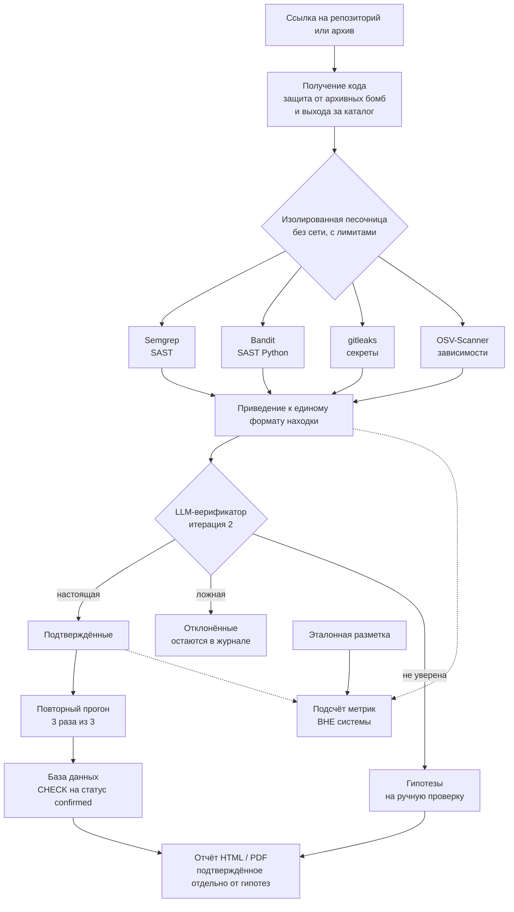
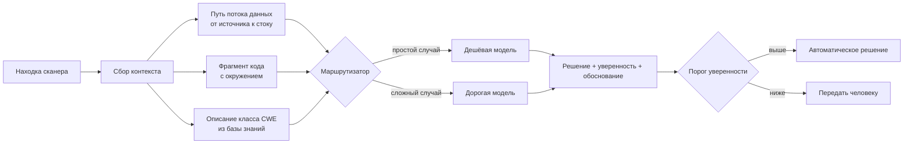
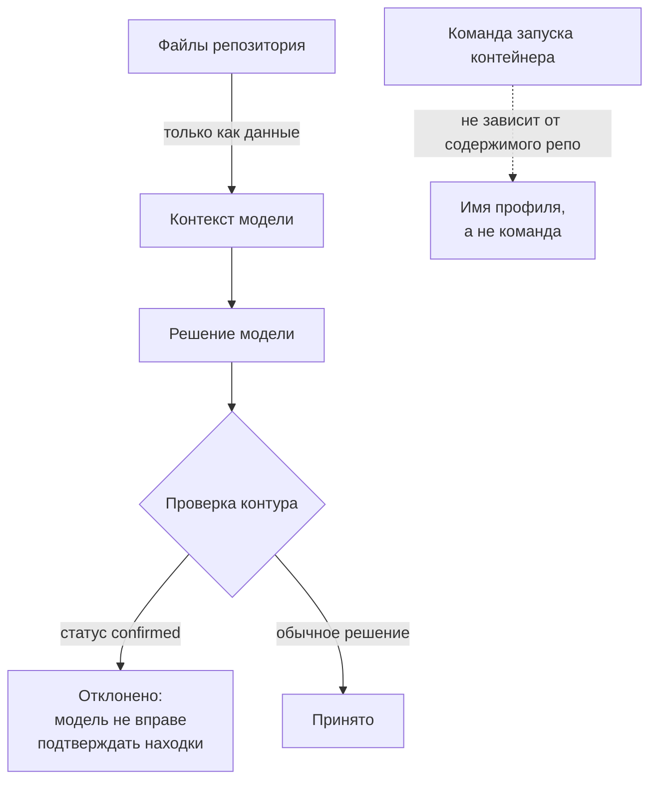

# Дизайн-документ ML-системы

**Проект:** агентный harness для аудита безопасности репозиториев с ИИ-сгенерированным кодом

**Автор:** Струков Артур Павлович, ИТМО

**Версия:** 2.0 · 2026-11-05

**Статус:** итерация 1 реализована и измерена, итерация 2 в разработке

---

## 1. Зачем идём в разработку продукта

### 1.1 Бизнес-цель

Объём кода, написанного с помощью ИИ-ассистентов, растёт быстрее, чем способность команд
его проверять. По исследованиям 2022–2026 годов от 25% до 45% ИИ-сгенерированного кода
содержит уязвимости. При этом существующие способы проверки плохо масштабируются:

| Способ | Ограничение |
|---|---|
| Ручной аудит / пентест | 5–30 тыс. долларов за приложение, сроки от двух недель |
| Детерминированные сканеры (SAST) | дёшево и быстро, но доля ложных срабатываний в промышленном коде превышает 90% |
| LLM без инструментов | почти не ошибается в том, что назвала, но находит каждую десятую уязвимость |

Возникает разрыв: дешёвые инструменты шумят, точные — дороги. Команда, выпускающая продукт
с ИИ-кодом, вынуждена либо платить за аудит, либо разбирать сотни предупреждений вручную,
либо выпускать без проверки.

### 1.2 Почему здесь нужен ML

Задача триажа находки — «это настоящая уязвимость или ложное срабатывание» — требует
понимания контекста приложения, а не совпадения с шаблоном. Это ровно та граница, где
детерминированные правила упираются в потолок, и ровно та задача, где языковая модель
применима: на вход подаётся путь потока данных и окружающий код, на выходе — решение и
обоснование.

Шесть независимых опубликованных работ 2025–2026 годов показывают сокращение ложных
срабатываний на 77–98% при сохранении полноты, когда LLM работает поверх вывода сканеров.
Самая осторожная из них (Frame, единственная с базовой линией, измеренной тем же автором
на том же корпусе) даёт прирост скромнее: F1 с 0.45 до 0.58. Это и есть реалистичный
ориентир, на который мы планируем.

### 1.3 Бизнес-метрики успеха

| Метрика | Текущее значение (итерация 1) | Целевое (итерация 2) |
|---|---|---|
| Доля ложных срабатываний в отчёте | 33% на OWASP Benchmark, 70% на собственном наборе | снижение не менее чем вдвое |
| Полнота (не пропустить уязвимость) | 0.790 | не ниже 0.750 — падение недопустимо |
| Время аудита репозитория | 1–15 минут машинного времени | не более 30 минут |
| Стоимость одного аудита | около нуля (только CPU) | до 1 доллара на репозиторий |

Ключевое ограничение на цель: **снижение ложных не должно достигаться ценой полноты**.
Система, которая молчит, бесполезна, даже если никогда не ошибается.

---

## 2. Бизнес-требования и ограничения

### 2.1 Пользователи и сценарии

| Роль | Сценарий | Что для неё важно |
|---|---|---|
| Разработчик / небольшая команда | прогнать проект перед релизом или выкладыванием в открытый доступ | скорость, понятность, мало шума |
| Аудитор безопасности | получить список кандидатов на ручную проверку, отсортированный по уверенности | полнота, прослеживаемость, воспроизводимость |
| Нетехнический заказчик | понять уровень риска продукта, который ему сдают | отчёт человеческим языком, разделение «подтверждено» и «гипотеза» |

### 2.2 Функциональные требования

1. На входе — ссылка на репозиторий или архив; на выходе — отчёт с находками.
2. Каждая находка содержит: файл, строки, класс уязвимости (CWE), серьёзность, объяснение
   и источник (какой инструмент или модель её дали).
3. Находки разделены на **подтверждённые** и **гипотезы**; смешивать их в отчёте запрещено.
4. Для каждой находки предлагается патч; применение патча обратимо.
5. Отчёт выгружается в HTML и PDF.

### 2.3 Нефункциональные требования и ограничения

**Безопасность исполнения (критично).** Система запускает недоверенный код и читает
недоверенный текст. Отсюда жёсткие требования, вынесенные в отдельную модель угроз:

- анализ только в изолированном контейнере: без сети, с лимитами памяти и числа процессов,
  с файловой системой только на чтение и снятыми привилегиями;
- содержимое анализируемого репозитория **никогда не управляет действиями агента** —
  текст из README не может изменить команду запуска или повысить привилегии;
- доля действий вне разрешённого списка целей должна быть **нулевой**, это проверяется
  отдельным набором враждебных тестов.

**Надёжность оценки.** Находка считается подтверждённой только при воспроизведении
3 раза из 3 в чистом окружении. Правило закреплено на уровне схемы БД ограничением
`CHECK (status <> 'confirmed' OR reproduced_runs >= 3)`, то есть выставить статус в обход
проверки не может ни пользователь, ни будущий LLM-слой.

**Честность измерений.** Метрики считаются **снаружи** системы отдельным кодом, чтобы
она не могла влиять на собственную оценку.

**Ресурсы.** Корпоративных ключей и GPU нет. Бюджет на модели — бесплатные лимиты
(Gemini Flash / Flash-Lite), поэтому дорогая модель применяется точечно, а массовые
операции уходят на дешёвую.

**Юридические и этические ограничения.** Корпус собирается только из открытых источников.
Модуль активной проверки работает исключительно на локальных учебных стендах; атаки на
чужие работающие системы исключены, в том числе в тестах.

### 2.4 Что считаем провалом

Проект считается неуспешным, если выполнено хотя бы одно:

- полнота упала ниже 0.750 ради снижения ложных срабатываний;
- хотя бы один враждебный сценарий пробил изоляцию песочницы;
- прирост качества от LLM-слоя статистически неотличим от нуля **и** при этом не измерена
  стоимость — то есть нет ни пользы, ни знания о цене.

Третий пункт важен: отрицательный результат при корректном измерении — приемлемый исход,
необъяснённый результат — нет.

---

## 3. Что входит в скоуп проекта и итерации

Проект разбит на итерации, каждая из которых соответствует одной из четырёх
сравниваемых конфигураций.

### 3.1 Итерация 1 — базовая линия (завершена и измерена)

**Входит:**

- изолированная песочница на Docker с проверенными враждебными тестами;
- четыре детерминированных сканера (Semgrep, Bandit, gitleaks, OSV-Scanner), приведение
  их вывода к единому формату находки;
- два размеченных эталона: собственный набор из 20 внедрённых уязвимостей и OWASP
  Benchmark 1.2 на 2740 кейсов;
- код подсчёта метрик вне системы, HTTP-интерфейс, база данных.

**Результат:** базовая линия, с которой сравнивается всё остальное.

### 3.2 Итерация 2 — LLM-верификатор (текущая)

**Входит:**

- классификатор «настоящая уязвимость / ложное срабатывание» поверх находок сканеров;
- подача модели пути потока данных, а не голого фрагмента кода;
- маршрутизация между дешёвой и дорогой моделью;
- измерение прироста и стоимости.

**Не входит:** дообучение модели, собственная модель, активная эксплуатация.

### 3.3 Что не входит в проект вообще

| Исключено | Почему |
|---|---|
| Обучение или дообучение своей модели | нет GPU и размеченного корпуса нужного объёма; задача решается промптингом поверх готовой модели |
| Автоматическое применение патчей без человека | цена ошибки в безопасности слишком высока; патч предлагается, решение принимает человек |
| Сканирование работающих чужих систем | этическое и юридическое ограничение, зафиксировано в модели угроз |
| Поддержка всех языков программирования | в скоупе Python, JavaScript/TypeScript и Java; остальные — за рамками |
| Интеграция с коммерческими платформами (Snyk, Sonar) | не нужна для научного результата |

### 3.4 Критерий завершения итерации

Итерация считается законченной, когда измерены precision, recall, F1 и стоимость прогона
на обоих эталонах, результат воспроизводится командой из одной строки, а ограничения
честно перечислены в отчёте.

---

## 4. Предпосылки решения

Допущения, на которых построена система. Если допущение окажется неверным, это меняет
архитектуру, поэтому каждое сопровождается проверкой.

| # | Допущение | На чём основано | Как проверяем |
|---|---|---|---|
| 1 | Сканеры дают высокую полноту при низкой точности | измерено нами: recall 0.790 при precision 0.669 на OWASP Benchmark | повторный замер на каждой итерации |
| 2 | LLM без инструментов даёт обратный профиль — высокую точность при низкой полноте | SecLens: precision 0.80 при recall 0.10 | итерация 3 воспроизводит это на наших данных |
| 3 | Связка «сканер как генератор кандидатов + LLM как верификатор» лучше каждого по отдельности | шесть опубликованных работ, сокращение ложных на 77–98% | итерация 2, прямое сравнение с нашей же базовой линией |
| 4 | Качество верификации зависит от того, **что** подано модели, а не только от модели | ZeroFalse: подача пути потока данных даёт F1 0.955 | A/B: фрагмент кода против пути данных |
| 5 | Статический анализ детерминирован, разброс метрик не маскирует эффект | измерено: три прогона, стабильность 1.000 | повтор при добавлении LLM, где разброс ожидается |
| 6 | Разметка выбранных эталонов пригодна для построчного сопоставления | у OWASP есть имя теста и CWE; строка требует отдельной локализации (уточнено EDA ДЗ2) | эталон без привязки к коду не используется для метрик |

Допущение 6 уже сработало как фильтр: OWASP Juice Shop пришлось исключить из подсчёта
метрик, потому что его разметка описывает эксплуатацию в рантайме и не содержит ни файла,
ни строки, ни класса уязвимости. Он остался только как описательный прогон.

---

## 5. Постановка задачи

### 5.1 Формулировка в терминах ML

**Задача:** бинарная классификация находок статического анализа.

- **Объект:** одна находка сканера — файл, диапазон строк, класс уязвимости (CWE),
  правило, фрагмент кода и путь потока данных от источника ввода до опасной операции.
- **Целевая переменная:** `1` — настоящая уязвимость, `0` — ложное срабатывание.
- **Разметка:** из эталонов. У собственного набора она известна по построению, у OWASP
  Benchmark берётся из файла `expectedresults-1.2.csv`.
- **Подход:** промптинг готовой языковой модели без дообучения; модель возвращает решение,
  уверенность и обоснование.

Классификатор работает **поверх** вывода сканеров, а не вместо него: это сознательное
решение, поскольку полнота у сканеров уже высокая, а узкое место — точность.

### 5.2 Метрики

**ML-метрики:**

| Метрика | Роль | Текущее значение |
|---|---|---|
| Recall | главное ограничение, не должен падать | 0.790 |
| Precision | то, что улучшаем | 0.669 |
| F1 | сводная | 0.725 |

**Правило сопоставления находки с эталоном** («один к одному»): эталонная уязвимость
закрывается не более чем одной находкой. Совпадением считается одинаковый файл и класс
уязвимости при разнице строк не больше допуска; пары разбираются жадно, от лучшего
совпадения к худшему. **Вторая находка на ту же уязвимость считается ложным срабатыванием** —
без этого дубли четырёх инструментов завышали бы точность, хотя разработчику всё равно
придётся разобрать каждую строку отчёта.

Устойчивость правила проверена: при допуске от 1 до 10 строк метрики не меняются, то есть
числа не подогнаны выбором параметра.

**Технические метрики:** время прогона, стоимость в токенах и деньгах, доля отказов
модели, стабильность между повторными прогонами.

### 5.3 Главный проверяемый результат

Сравнение четырёх конфигураций на одних репозиториях, одной модели и одном бюджете:

| # | Конфигурация | Статус |
|---|---|---|
| 1 | Только детерминированные инструменты | измерена |
| 2 | Инструменты + LLM-верификатор | в разработке |
| 3 | LLM без инструментов | запланирована |
| 4 | Сторонний открытый харнес на той же модели | запланирована |

**Δ(2−1)** — вклад модели. **Δ(2−3)** — вклад инструментов и оркестрации.

Такого сравнения на единых условиях в рассмотренных работах не найдено: у каждой работы
свой корпус и своя базовая линия. Это и есть исследовательский вклад проекта.

### 5.4 Где именно ожидается прирост

Карта по классам уязвимостей, измеренная на OWASP Benchmark, показывает, что прирост
возможен не везде:

| Класс | Recall | Ложных | Есть ли запас для LLM |
|---|---|---|---|
| CWE-330, CWE-327, CWE-614 | 1.000 | 0 | нет, улучшать нечего |
| CWE-89, CWE-78, CWE-22 (инъекции) | 0.90–0.93 | сотни | да, по точности |
| CWE-79 (XSS) | 0.821 | 108 | да, по обоим |
| CWE-501 (граница доверия) | **0.518** | 18 | да, по полноте |

Там, где признак локален — вызов конкретной функции, отсутствие флага, — полнота уже
равна единице при нуле ложных, и модель не нужна. Там, где требуется понять замысел
приложения, полнота падает до 0.518. Это измеренная, а не предполагаемая цель итерации 2.

---

## 6. Блок-схема решения

### 6.1 Общий конвейер

Пунктирные стрелки показывают важную деталь: подсчёт метрик вынесен за пределы системы и
получает её вывод как внешние данные. Система не имеет доступа к эталонам и не может
влиять на собственную оценку.

### 6.2 Как устроен LLM-верификатор

Подача модели **пути потока данных**, а не только фрагмента кода — ключевое проектное
решение, взятое из работы ZeroFalse: в ней показано, что качество верификации зависит
прежде всего от того, что подано на вход, а не от размера модели.

### 6.3 Защита от внедрения инструкций

Отдельный контур, обязательный, поскольку система читает недоверенный текст:

Содержимое репозитория попадает в модель только как данные. Команда запуска контейнера
формируется из имени профиля и физически не может быть изменена текстом из анализируемого
кода. Статус «подтверждено» модель выставить не может: это запрещено ограничением в схеме
базы данных. Контур проверен враждебным тестом с внедрённой инструкцией в README —
команда не изменилась, уязвимость рядом с инструкцией всё равно найдена.

---

## 7. Данные

### 7.1 Эталоны

| Эталон | Размер | Лицензия | Разметка | Годен для метрик |
|---|---|---|---|---|
| Собственный seeding-набор | 14 файлов, 20 уязвимостей, 15 CWE | наш код | файл + строка + CWE, журнал генерируется из исходников | **да**, полный эталон |
| OWASP Benchmark 1.2 | 5725 файлов, 76 МБ | GPL-2.0 | 2740 кейсов: 1415 уязвимых и 1325 безопасных | **да**, есть и безопасные случаи |
| OWASP Juice Shop | 1496 файлов, 321 МБ | MIT | 116 заданий без привязки к коду | нет, только описательно |
| DVWA | 281 файл, 3 МБ | GPL-3.0 | только документация | нет, только описательно |

Собственный набор устроен так, что журнал эталонов **вычисляется из самого кода**, а не
ведётся вручную: разойтись с исходниками он не может. Соблюдён инвариант — два эталона в
одном файле не ближе 10 строк, иначе допуск по строкам склеил бы разные уязвимости.

Состав намеренно неравномерный: 9 простых случаев, 6 средних, 5 сложных. Сложные внедрены
непрямо — через промежуточную переменную, значение из конфигурации или соседнюю функцию.
Без них полнота завышалась бы на учебных шаблонах.

### 7.2 Защита от утечки в обучающую выборку

OWASP Benchmark — публичный и давно существующий набор, поэтому он почти наверняка попал
в обучающие данные языковых моделей. Для итерации 2 это означает риск завышенной оценки.
Меры:

- основной вывод делается по **собственному** seeding-набору, которого в открытых данных нет;
- для внешней проверки планируется CVEfixes с фильтром по дате: берутся уязвимости,
  опубликованные позже среза знаний модели;
- OWASP Benchmark остаётся для сопоставления с опубликованными результатами, а не как
  единственное основание выводов.

---

## 8. Риски

| Риск | Вероятность | Последствие | Что делаем |
|---|---|---|---|
| Прирост от LLM окажется в пределах погрешности | средняя | главный результат под вопросом | планируем по осторожной оценке (Frame, +0.13 F1), а не по громким процентам; отрицательный результат при корректном измерении публикуем как результат |
| Модель запомнила публичный эталон | высокая | завышенная оценка качества | основной вывод по собственному набору, внешняя проверка на свежих CVE |
| Внедрение инструкций через содержимое репозитория | средняя | модель выполняет чужую команду | репозиторий только как данные, команда из имени профиля, статус confirmed недоступен модели; проверено враждебным тестом |
| Исчерпание бесплатных лимитов модели | высокая | прогоны останавливаются | маршрутизация дорогая/дешёвая, дешёвая модель на рутину, повторы с выдержкой |
| LLM снижает полноту, отбрасывая настоящие находки | средняя | система пропускает уязвимости | recall — жёсткое ограничение; при падении ниже 0.750 итерация считается неуспешной |
| Недетерминированность модели мешает воспроизводимости | высокая | метрики измеряют шум | фиксируем температуру и версию модели, три прогона, публикуем разброс |

---

## 9. Текущие результаты

Итерация 1 завершена и измерена.

| Эталон | Precision | Recall | F1 |
|---|---|---|---|
| OWASP Benchmark 1.2 (строгое равенство CWE) | 0.669 | 0.790 | **0.725** |
| OWASP Benchmark 1.2 (с учётом семейств CWE) | 0.693 | 0.882 | 0.776 |
| Собственный seeding-набор | 0.302 | 0.800 | **0.438** |

Опубликованные результаты на том же эталоне: Semgrep CE F1 = 0.694, CodeQL F1 = 0.744.
Наши числа того же порядка, то есть методика сопоставления корректна. Прямым сравнением
инструментов это **не является**: набор правил у нас вендоренный, а не из официального
реестра, и выдавать совпадение за превосходство было бы некорректно.

Дополнительно проверено:

- **изоляция** — 7 враждебных сценариев из 7, при работающей канарейке: тот же сценарий
  при намеренно ослабленной политике обязан провалиться и проваливается;
- **воспроизводимость** — три независимых прогона по 111 находок, стабильность 1.000.

Низкая точность при высокой полноте — не дефект реализации, а измеренная характеристика
класса инструментов, и именно она задаёт место для вклада модели в итерации 2.

---

## 10. Источники

1. «Sifting the Noise» — сравнение SAST на OWASP Benchmark, arXiv:2601.22952
2. «ZeroFalse» — подача пути потока данных модели, arXiv:2510.02534
3. «RealSec-bench» — арбитраж несколькими моделями, arXiv:2601.22706
4. «LMPFA» — промышленная фильтрация ложных срабатываний, arXiv:2601.18844
5. «QASecClaw» — мульти-агентная фильтрация, arXiv:2605.01885
6. «SAST-Genius» — LLM-триаж поверх Semgrep, arXiv:2509.15433
7. «SecLens» — оценка LLM без инструментов, arXiv:2604.01637
8. Frame — LLM в связке с разделяющей логикой, LambdaSec
9. OWASP Benchmark — https://github.com/OWASP-Benchmark/BenchmarkJava
10. Шаблон дизайн-документа Reliable ML — https://github.com/IrinaGoloshchapova/ml_system_design_doc

---

## 11. Этапы решения задачи

Версия ДЗ2 от 2026-11-05. Этапы ниже описывают план реализации; выполненная часть —
[EDA](../reports/eda.md) с [численными результатами](../reports/eda_summary.json).
Результаты раздела 9 перенесены из ДЗ1 и в рамках ДЗ2 не воспроизведены: исходные
находки и собственный seeding-корпус в репозиторий не включены.
Структура учитывает [шаблон](https://github.com/IrinaGoloshchapova/ml_system_design_doc_ru/blob/main/ML_System_Design_Doc_Template.md).

### Этап 1. Подготовка данных

**Сущности и источники.** Единица прогнозирования — находка, а единица эталона OWASP —
тестовый файл. Связь не один к одному: возможны несколько находок и отсутствие находок.
Сохраняем repository_id, commit, язык, scanner/version/rules_hash, rule_id, CWE,
file/lines, snippet, dataflow, source_hash, label, label_source и annotation_status.
Отдельно сохраняем реестр всех эталонов, включая пропущенные сканером: иначе нельзя
посчитать end-to-end recall. Секреты из gitleaks и уязвимости зависимостей OSV требуют
отдельного типа сущности и правил проверки; их не смешиваем с классификацией Java SAST.

**Что показал EDA.** Изучены реальные исходники и CSV OWASP на фиксированном commit:
2740 кейсов, 11 CWE, 1415 положительных и 1325 отрицательных, без пропусков полей,
повторов ID и потерянных файлов. Найдены четыре повтора сверх первого после удаления
комментариев и нормализации имен. Длина исходника: 51–206 строк, медиана 100.
Точные алгоритм и ограничения проверки приведены в отчете. CSV не содержит строк:
для построчного matching нужна дополнительная экспертная локализация. Safe-кейс не
является автоматически отрицательной находкой: сначала необходимо запустить сканер.
Риски: шаблонная зависимость, дисбаланс CWE, запоминание публичного корпуса и отсутствие
Python/JS и доказанного происхождения кода от ИИ. На этом корпусе нельзя доказать
специфическое преимущество на ИИ-сгенерированном коде.

**Генерация и обновление.** DE фиксирует Git SHA, лицензию и хеши CSV/исходников;
изолированный runner по запросу запускает закрепленные версии сканеров и пишет raw JSON.
Адаптеры преобразуют его в JSONL без потери исходного rule_id. DS проверяет схему,
нормализует пути/CWE, группирует дубли, сопоставляет с эталоном и сохраняет manifest.
Новый commit проекта или версия правил запускают новый snapshot; старый не перезаписывается.
OWASP — статический диагностический релиз, обновление только явно, с повторным EDA.
Ежедневный сбор для учебного MVP не требуется.

**Разметка.** Эксперт безопасности проверяет неоднозначные совпадения; неизвестные
исключаются из supervised-оценки с публикацией их доли. Для нового корпуса два эксперта
независимо размечают все test-примеры и 20% development, разногласия разрешает третий.
Сохраняются основания решения; отсутствие срабатывания нельзя считать доказательством
безопасности. После дедупликации считаем качество итогового отчета; сырой поток оцениваем
отдельно, чтобы видеть нагрузку от дублей.

**Достаточность.** Публичных 2740 тестов достаточно для EDA, но не для вывода о production.
Собственные 20 уязвимостей из ДЗ1 дают слишком грубую оценку полноты: одна ошибка — 5 п.п.
Начальный дополнительный сбор: 1000 находок из >=20 независимых проектов, с Python,
JS/TS и Java, включая >=300 положительных в закрытом test. При recall около 0.75
300 независимых положительных дают ориентировочную 95% погрешность около 5 п.п.;
кластеризация по проектам увеличит ее. Это план, а не достигнутая гарантия. Если
интервалы широки, расширяем число проектов и редкие CWE; объем уточняем по кривой
качества/объема и cluster bootstrap. Свежие CVE с датами и ручной проверкой добавляем
только после проверки лицензий; неизвестный training cutoff модели не позволяет
гарантировать отсутствие contamination одним фильтром даты.

**Конфиденциальность.** Учебный OWASP публичен; это не полноценная проверка PII.
В рабочих репозиториях возможны персональные данные и реальные ключи. Перед LLM
маскируем секреты, не пишем их в логи; доступ к коду по ролям, хранение зашифровано,
срок хранения контекста пилота 30 дней. Внешний API разрешаем только для согласованного
кода с подходящими условиями обработки; иначе локальная модель или ручной разбор.
Маскирование проверяем на сохранение смысла потока данных.

**Выход.** Для бейзлайна: версионированный корпус, raw/normalized findings, EDA и matching
с проверенной разметкой. Для MVP: дополнительно независимый holdout по проектам,
протокол разметки, data contract и manifest splits. Готовность подтверждают DS и эксперт:
все обязательные поля заполнены, все test-объекты имеют provenance и нет пересечений групп.

### Этап 2. Подготовка прогнозных моделей

**Цель и потери.** y=1 означает реальную уязвимость в кандидате SAST. Модель готовая,
дообучения нет, поэтому тренировочная loss не оптимизируется. Для выбора промпта и
порога минимизируем число FP при ограничении end-to-end recall >=0.750 и бюджете
<=1 доллар / <=30 минут на репозиторий. Recall связан с пропущенным риском,
precision — с ручной нагрузкой. Публикуем TP/FP/FN, precision, recall, F1, F2,
macro по CWE и разрезы языков/проектов; accuracy не является критерием выбора.
F2 сильнее штрафует пропуски. Условный recall верификатора считаем отдельно:
TP после фильтра / TP сканера; он не заменяет полноту относительно всего эталона.
Снижение доли ложных срабатываний вдвое проверяем как FP/(TP+FP), дополнительно
показываем абсолютное FP. Для вероятностного выхода измеряем Brier score; словесная
уверенность LLM не считается калиброванной вероятностью. Если позже обучаем
классификатор, используем weighted binary cross-entropy с весами только из train.

**Валидация.** Реальные проекты распределяем train/dev/test 60/20/20 по группам проекта,
форка и близких шаблонов, фиксируем seed=42 и manifest. Пары исправленный/уязвимый код
остаются в одной группе. Train используется для few-shot примеров, dev — для выбора
промпта, маршрутизации и порога; test открывается один раз после фиксации конфигурации.
На малом числе проектов используем group cross-validation внутри development.
OWASP оцениваем отдельно: семьи шаблонов группируем, найденные нормализованные дубли
не разделяем. Название теста, комментарии с ответом, CSV и expected label в контекст
модели не попадают. Внешнюю проверку делаем на новых проектах и более поздних snapshots.
Три повтора LLM на одинаковых входах; версии, параметры, ответы и токены сохраняем.
95% интервалы и интервал разности с бейзлайном считаем парным bootstrap по проектам
(для OWASP по семьям шаблонов), а не по зависимым находкам. Если данных недостаточно
для нижней границы recall >=0.750, результат остается исследовательским.

**Бейзлайн.** B0 сохраняет все дедуплицированные находки закрепленных SAST-инструментов.
B1 — тот же поток + одна доступная модель с фиксированным zero-shot промптом,
фрагментом кода, CWE и JSON-ответом {decision, rationale, evidence_lines}.
Пути приводим к относительным, контекст ограничиваем бюджетом токенов; код не исполняем.
Невалидный JSON, таймаут и отсутствие контекста дают abstain и сохраняют находку для
ручной проверки. LLM не вправе выставлять confirmed. Модель-фильтр не может найти
уязвимость, которой нет в кандидатах: увеличение recall требует отдельного генератора.

**MVP и развитие.** Добавляем source-to-sink путь и санитайзеры, извлечение контекста
по AST/зависимостям, few-shot из train, маршрутизацию дешевой/более сильной модели.
На dev сравниваем максимум 12 заранее описанных конфигураций: контекст (фрагмент/путь),
few-shot (0/3), три порога отклонения. Модели и их точные ID фиксируем по фактической
доступности до эксперимента. Последовательные ablation показывают вклад каждого
изменения; test не используется для подбора. Кеш ключуется хешем кода, промпта и модели.
Пересчет решения нужен при изменении кода, правил или версии модели; переобучения по
расписанию нет. Порог допускает отклонение только при достаточной уверенности,
все остальные кандидаты сохраняются.

**Интерпретация и риски.** Эксперт проверяет все FN и стратифицированную выборку FP/TP
по CWE; связывает решение с конкретными строками, источником, стоком и санитайзером.
Объяснение LLM не является доказательством. Таблица ошибок разделяет нехватку контекста,
ошибку matching, injection, неверный CWE и ошибку модели. Анализ чувствительности к
переименованию идентификаторов и удалению комментариев выявляет shortcuts. Риски:
контаминация, снижение recall, нестабильность, лимиты API; меры — holdout, conservative
abstain, повторы, ограниченные retries и учет стоимости всех попыток.

**Выход.** Бейзлайн — воспроизводимый внешний evaluator и таблица метрик B0/B1.
MVP — закрепленные промпт/модель/порог, интервалы качества, ablation, журнал FN и
измеренные latency/cost. DS и эксперт принимают улучшение только при выполнении
ограничений recall и бюджета; статистически неясный результат требует расширения
корпуса, а не заявления об успехе.

### Этап 3. Безопасное исполнение и проверка находок

Бейзлайн: только статический анализ в контейнере без сети, read-only исходники,
непривилегированный пользователь, лимиты CPU/RAM/PID/времени, разрешенные команды из
профиля. Проверяем выход за каталог, симлинки, архивные бомбы и injection в README/коде.
MVP: воспроизведение только на локальном разрешенном стенде, три независимых чистых
запуска с проверкой наблюдаемого эффекта. Три одинаковых предупреждения SAST не доказывают
эксплуатируемость. Без подходящего безопасного воспроизведения статус — гипотеза.
Для зависимостей и секретов нужны собственные процедуры подтверждения.
Риски — выполнение недоверенных команд и ложное подтверждение; политика enforced вне LLM,
проверка evidence обязательна. Выход: протокол изоляции с негативными контролями,
артефакты трех запусков и запрет confirmed без evidence на уровне сервиса и БД.
Любое нарушение изоляции блокирует пилот независимо от ML-метрик.

### Этап 4. Отчет, патчи и экспертная проверка

Бейзлайн: JSON/HTML с файлом, строками, CWE, источником и неопределенностью.
MVP: PDF, evidence, предлагаемый diff и журнал решений эксперта; патчи применяются
только человеком. Проверка патча — синтаксис, существующие тесты и повторный анализ
в чистом контейнере; исчезновение сигнала само по себе не подтверждает исправление.
Неизвестные и подтвержденные случаи отображаются отдельно. На пилоте эксперт измеряет
время разбора находки и долю принятых патчей; риск — убедительное, но ошибочное объяснение.
Выход: прослеживаемый отчет и обратная связь, привязанная к версии кода; исправленные
метки попадают только в следующую версию корпуса, не меняют замороженный test задним числом.

### Этап 5. Пилот и мониторинг

Бейзлайн: shadow-прогон B0 на согласованных проектах. MVP: парный offline/shadow прогон
B0 и B1 на тех же commits, без автоматического скрытия кандидатов от эксперта.
План — >=20 проектов с языковыми стратами; если интервалы не позволяют принять решение,
расширяем пилот. Измеряем recall >=0.750, снижение FP-доли >=2 раз, стоимость <=1 доллар
и время <=30 минут на проект; отдельно p50/p95 и долю таймаутов. Стоимость включает все
маршруты и retries; считаем по фактическим токенам и тарифам, бесплатный лимит не
приравниваем к нулевой экономической стоимости. Разработчик/эксперт оценивает время
разбора и полезность evidence. До получения этих результатов критерии являются целями.

После пилота наблюдаем состав CWE/языков, размеры контекста, abstain, ошибки API,
стоимость и задержки каждого прогона; качество проверяем на ежемесячной экспертной
выборке и при смене модели/правил. Дрейф состава сам по себе не доказывает падение
качества, но запускает разметку. При recall ниже порога или сбое LLM откатываемся к B0,
сохраняя кандидатов; при нарушении изоляции останавливаем анализ. Выход: отчет пилота,
решение go/no-go, владелец мониторинга и проверенная процедура отката.
