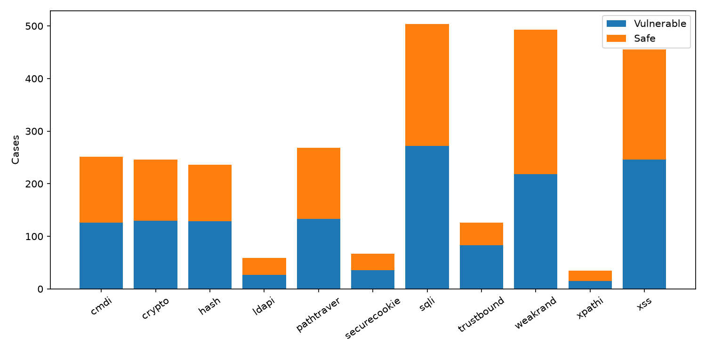
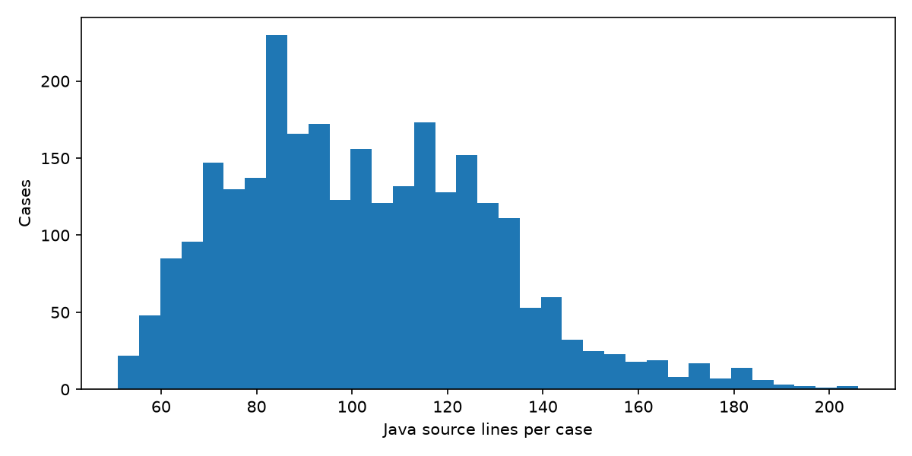

# EDA: корпус для верификатора SAST

Анализ выполнен 2026-11-05. Источник: https://github.com/OWASP-Benchmark/BenchmarkJava , commit `0119da404a3418bc337beb529b72ae755f018f97`. Разметка `expectedresults-1.2.csv`, SHA-256 `f0311c850dea7f15125113f7cfdbd7ad612d7f5951c7331584f6981b6ae2d630`. Корпус GPL-2.0; исходники не копируются в репозиторий сдачи.

## Состав и качество

Единица анализа — тестовый Java-файл; это не находка сканера. Всего 2740 кейсов, {'true': 1415, 'false': 1325}, 11 категорий / 11 CWE. Пропущенных полей: 0; повторов ID: 0; отсутствующих исходников: 0. Точных повторов файлов сверх первого: 0; после удаления комментариев, пробелов и нормализации имени теста: 4. Эта эвристика не доказывает независимость остальных кейсов.

| Категория | Уязвимые | Безопасные |
|---|---:|---:|
| cmdi | 126 | 125 |
| crypto | 130 | 116 |
| hash | 129 | 107 |
| ldapi | 27 | 32 |
| pathtraver | 133 | 135 |
| securecookie | 36 | 31 |
| sqli | 272 | 232 |
| trustbound | 83 | 43 |
| weakrand | 218 | 275 |
| xpathi | 15 | 20 |
| xss | 246 | 209 |



Общий баланс близок к равному, но объем категорий различается. Accuracy скроет слабые CWE: нужны метрики по категориям и macro-average. Доля безопасных кейсов не равна доле ложных срабатываний: последняя зависит от сканера.



Число строк min/median/max: {'min': 51, 'median': 100, 'max': 206}. Длина файла помогает оценить размер контекста, но строки не равны токенам: лимит и стоимость нужно измерить токенизатором выбранной модели. Обрезка контекста может удалить санитайзер или источник и исказить решение.

## Ограничения разметки и переносимости

CSV содержит имя теста, категорию, boolean и CWE, но не номер строки. Утверждение ранней версии дизайн-документа о наличии строки в CSV требует исправления: точную локализацию надо получать отдельно и проверять вручную. CWE следует брать из файла, а не восстанавливать по названию категории.

Корпус синтетический и Java-only. Он не подтверждает качество на Python/JS, реальных проектах и ИИ-коде. Публичность создает риск запоминания LLM. Комментарии и имена тестов могут выдавать принадлежность бенчмарку: их исключают из контекста модели. Даже при отсутствии точных дублей общий шаблон кода создает утечку между случайными train/test.

Собственный набор из 20 уязвимостей и сырые результаты четырех сканеров отсутствуют в ветке hw_1. Поэтому precision/recall, дубли находок, покрытие инструментов и качество разметки этого набора здесь не измерены. Числа ДЗ1 не являются результатом данного EDA. Без находок невозможно построить распределение именно целевой переменной верификатора.

## Решения по результатам EDA

1. Зафиксировать commit и хеш разметки; проверять схему и соответствие исходникам при обновлении.
2. Сначала собрать JSONL находок и provenance, затем сопоставить с эталоном; неизвестное совпадение передать эксперту, не объявлять автоматически ложным.
3. Разбивать по проектам и семействам шаблонов, удерживать парные safe/vulnerable примеры вместе. OWASP использовать как отдельный диагностический корпус.
4. Добавить реальные Python/JS-проекты и отрицательные примеры. Начальный план — 1000 размеченных находок из >=20 проектов; достаточность проверить learning curve и доверительными интервалами, а не считать гарантированной.
5. Не запускать учебный уязвимый код для EDA. Наличие публичных исходников не дает разрешения отправлять частный код внешней модели.

## Воспроизведение

Из корня репозитория:

```sh
python -m pip install -r requirements-eda.txt
git clone https://github.com/OWASP-Benchmark/BenchmarkJava.git data/raw/BenchmarkJava
git -C data/raw/BenchmarkJava checkout 0119da404a3418bc337beb529b72ae755f018f97
python scripts/eda.py
```

Скрипт читает только локальные файлы, не исполняет анализируемый код и сохраняет два графика, JSON и этот отчет. Машинные результаты: [eda_summary.json](eda_summary.json).
